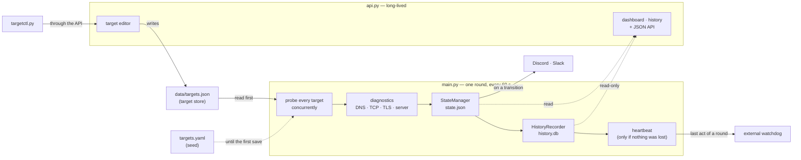

# SRE Health Checker

[](https://github.com/DDRG15/vigil-sre/actions/workflows/ci.yml)

**Engineering is the art of preventing the predictable.**

> Source-available under [PolyForm Strict 1.0.0](LICENSE), not open source.
> Hiring teams are welcome to clone and run it to evaluate my work.
> For any other use, ask.

This is not a monitoring script. It is a monitoring microservice — the distinction
matters. A script does a job. A microservice has a contract. This one's contract is
simple: if something is wrong, you will know. Once. Not seventeen times.

---

## Project Vision

High-availability systems deserve high-availability monitoring. The irony of watching
a production API serve five-nines uptime while your health checker silently crashes
on a stale Python environment is not lost on this codebase.

This tool was built on a single premise: if you are going to monitor infrastructure,
do it without apology. No half-measures, no "good enough for now," no commented-out
TODOs that survive three release cycles. Every architectural decision in this project
traces back to one question: what happens at 3 AM when nobody is watching?

The answer should always be: the system handles it, logs it cleanly, and pages you
exactly once if your intervention is required.

---

## How it fits together

Two processes, and neither imports the other. The monitor runs one round and exits;
compose starts the next one 60 seconds later. The API is the only process that
writes the target list.



---

## The Zero-Debt Architecture

The following decisions are not preferences. They are conclusions.

### Asynchronous Concurrency

Synchronous execution is a bottleneck we do not accept.

A sequential health checker that probes ten URLs with a five-second timeout takes
up to fifty seconds to complete a single run. That is not monitoring. That is a very
slow tour of your own infrastructure. By the time it finishes, the incident you were
meant to catch has already escalated.

This service uses `asyncio` with `aiohttp` to dispatch every probe simultaneously.
Wall-clock time becomes a function of your slowest target, not the sum of all of
them. A single shared `aiohttp.ClientSession` reuses the underlying TCP connector
and DNS resolution cache across all concurrent requests — the same reason you do not
instantiate a new database connection per query.

Time is the only resource you cannot recover. We do not spend it waiting in line.

### Atomic State Integrity

We do not tolerate corrupted state files.

The alert fatigue problem is well-understood: a service goes down at 2 AM, your
webhook fires every five minutes for six hours, and by morning your on-call engineer
has learned to ignore Discord notifications entirely. This is a monitoring failure
masquerading as an operational one.

State is persisted to `state.json` after every probe, and alerts fire only on
confirmed transitions: DOWN after two consecutive failed rounds, Slow after three
consecutive slow checks, and the matching all-clear once — never once per check.
The implementation uses two layers of protection to ensure the system's memory is
as reliable as its logic.

First, all concurrent writes pass through an `asyncio.Lock`. Because every coroutine
runs in a single OS thread, this is a zero-overhead cooperative yield point — not a
threading primitive — that prevents two probes from interleaving a read-modify-write
cycle on the shared state dictionary.

Second, all disk writes are atomic. State is serialized to a `.tmp` file and then
renamed into place. On POSIX systems, `rename(2)` is a single kernel syscall. A
process killed between the write and the rename leaves the previous `state.json`
intact. You do not get a zero-byte file. You do not get partial JSON. The state is
either the old version or the new version. There is no third option.

### Manual Retry Logic

We distinguish between a blip and a failure. Most monitoring tools do not.

A CDN under brief load returns a 503 for 800 milliseconds and self-heals. A Python
service with a misconfigured environment variable returns a 500 indefinitely. Firing
an identical alert for both is noise, and noise trains engineers to ignore alerts. The
consequences of that training are well-documented in post-mortems.

This service implements custom exponential backoff before declaring a target DOWN.
Up to three attempts are made per check cycle, with sleep intervals that grow
geometrically: two seconds, then four, capped at ten. The arithmetic is intentional.
Transient failures resolve within one retry window. Persistent failures do not.

The retry logic is hand-rolled rather than delegated to a library. This is a
deliberate choice. During an incident at 3 AM, the engineer reading this code needs
to understand exactly what it does without navigating third-party decorator internals.
The loop is fourteen lines. Every line is load-bearing.

Alerts are not a feature. They are a last resort. They should fire when, and only
when, a human is actually needed.

### Multi-Stage Docker Build

This is not about portability. Portability is a side effect. This is about security.

The production image is built in two stages. The builder stage installs dependencies
using pip, which may invoke a C compiler for native extensions. The runtime stage
copies only the compiled packages — it contains no pip, no compiler, no build
toolchain, and no mechanism for an attacker to install anything new. The attack
surface is a function of what is present. We keep that number low.

The base image ships pip, setuptools and wheel, so the runtime stage removes them,
and `python -m pip` inside the image answers "No module named pip".

The process runs as a dedicated, unprivileged system user with no login shell
(`/usr/sbin/nologin`) and no home directory. Root access inside a container is not a theoretical risk; it is a
practical one when combined with a misconfigured volume mount or a container runtime
vulnerability. We do not require root. We do not request it.

Application secrets and target configuration are passed in at runtime via environment
files and bind mounts. They do not appear in image layers. They do not appear in
`docker history`. They are not baked into an artifact that will be pushed to a
registry, scanned by a pipeline, cached by a CI runner, or rotated by a frustrated
platform engineer six months from now.

---

## Prerequisites

- Docker and Docker Compose — or, to run it without Docker or to run the tests,
  Python 3.11 or newer (see "Run without Docker")
- A Discord Webhook URL (Server Settings > Integrations > Webhooks)
- Optionally a Slack Incoming Webhook — alerts go to both at once, see
  "Multi-channel alerting"
- Two minutes of focused attention

---

## Deployment

### 1. Configure secrets

```bash
cp .env.example .env
```

Open `.env` and replace the placeholder with your real Discord Webhook URL. Add
`SLACK_WEBHOOK_URL` too if you want the second channel — every alert goes to every
configured channel. Do not commit this file. It is in `.gitignore` for a reason.

### 2. Configure targets

```bash
# Edit targets.yaml — add or remove URLs under the targets: key.
# No code changes required. The service reads this file at startup.
nano targets.yaml   # macOS / Linux
notepad targets.yaml   # Windows
code targets.yaml      # VS Code (any platform)
```

The file is plain text. Any editor works.

`targets.yaml` is the seed: the list the monitor runs on until the first save from
the dashboard editor or from `targetctl.py`. From then on the list lives in
`data/targets.json` and edits to `targets.yaml` are no longer read — change targets
with `python targetctl.py add|remove` (see "Changing targets from a terminal") or
from the dashboard.

### 3. Deploy

```yaml
# docker-compose.yml
services:
  health-checker:
    build: .
    env_file: .env
    environment:
      # state.json and the history database both need a directory mount, not a
      # single-file one — see the comments in the repo's docker-compose.yml for why.
      - STATE_FILE_PATH=/app/data/state.json
      - HISTORY_DB_PATH=/app/data/history/history.db
    volumes:
      - ./targets.yaml:/app/targets.yaml:ro
      - ./data:/app/data
      - ./data/history:/app/data/history
    restart: unless-stopped
    # The loop forwards SIGTERM to the running round, so `stop` is clean; see
    # the repo's docker-compose.yml for why a bare `while` loop could not.
    command:
      - sh
      - -c
      - |
        trap 'if [ -n "$$pid" ]; then kill -TERM "$$pid" 2>/dev/null; wait "$$pid"; fi; exit 0' TERM
        while true; do
          python main.py &
          pid=$$!
          wait "$$pid"
          rc=$$?
          pid=
          sleep 60 &
          pid=$$!
          wait "$$pid"
          pid=
          [ "$$rc" -eq 0 ] || exit 1
        done
    stop_grace_period: 150s
```

```bash
# Build the image and start the service.
docker compose up -d --build

# Confirm it is running.
docker compose ps

# Follow the log stream.
docker compose logs -f
```

That starts the monitor and the dashboard, and nothing else. The self-hosted
watchdog demo is opt-in (`--profile demo-watchdog`, see "Try it without signing up
for anything"), so a first install does not depend on a key that `.env.example`
cannot contain. The history database lives at `data/history/history.db`; the
`data/history/` directory ships with the clone on purpose, so Docker never has to
create it.

**On a Linux host**, the container runs as a non-root user that is not your host
user, so it cannot write to a `data/` you own. Give it access once, before the
first `up`:

```bash
chmod -R a+rwX data
```

Docker Desktop on Windows and macOS does not enforce host permissions and needs
nothing.

**Upgrading an install that mounted `./history.db`.** Stop the stack, move the
file into the new directory, start it. If Docker already created a *directory*
named `history.db` in the project root (the symptom was `History schema init failed
... unable to open database file` on every round), it holds no data — remove it
instead of moving it:

```bash
docker compose down
mv history.db data/history/history.db     # a real file with your history in it
# rm -r history.db                        # ...or, if it is an empty directory
docker compose up -d --build
```

To stop cleanly — the service handles SIGTERM and completes any in-flight checks
before exiting:

```bash
docker compose down
```

That used to be a claim the container could not keep. PID 1 was a bare `sh`
loop, which never passed SIGTERM on, so compose waited its 10 seconds and sent
SIGKILL on every stop — measured at 9.9 s and exit 137, mid-round or not. The
loop now forwards the signal to whatever is running: measured at under 5 s and
exit 0, with a round that was in flight allowed to finish first. A round that
fails still ends the container with status 1 and the restart policy brings it
back, but only after the 60-second pause: exiting at once let Docker's restart
backoff set the pace, and a persistent failure re-ran rounds 19–31 s apart,
hammering every target and the webhook (measured; with the pause, 76–81 s).
`stop_grace_period` (150 s)
is a ceiling, not a delay, sized for the default per-target timeout: three
attempts with backoff plus the worst-case alert delivery fit inside it. It does
not cover every allowed setting — `timeout_s` accepts up to 300 s per attempt, so
a stop that lands during a probe of such a target can still end in SIGKILL before
that round finishes. Keep long timeouts for the targets that need them.

### 4. Verify the alerting pipeline

The shipped `targets.yaml` watches four public endpoints. Three are normally
healthy; `httpbin.org/status/200` is a public test service that is unavailable a
good part of the time, so on some first runs it alerts and on others it does not.
A healthy target seen for the first time is recorded, not announced — it was
never down, so there is nothing to "recover" from — which means a fresh install
that finds everything up sends nothing at all. That is correct, and it proves
nothing about your channels. To prove them, add a target that cannot
answer for one run:

```yaml
  - url: http://127.0.0.1:9/   # a refused port on the monitor's own loopback
```

Its first sighting is a DOWN, which alerts once on every configured channel.
Confirm the alert arrives, then remove the entry. A target found DOWN or
DEGRADED is recorded on the first slow observation, but its notification requires
three consecutive slow checks. A first healthy sighting stays quiet.

### 5. Run without Docker (optional)

Python 3.11 or newer. The runtime needs three packages, pinned in
`requirements.txt`; install them in a virtual environment so they do not touch
anything else on the machine:

```bash
python -m venv .venv
source .venv/bin/activate          # Windows PowerShell: .venv\Scripts\Activate.ps1
pip install -r requirements.txt
cp .env.example .env               # Windows: copy .env.example .env — then add your webhook

python main.py                     # one round: probe every target, alert, exit
python main.py --report            # the history table, without probing
python api.py                      # dashboard and API at http://127.0.0.1:8787
```

`main.py` runs one round and exits by design (see "No built-in scheduling"). For
continuous monitoring without Docker, run it every 60 seconds from cron or the
Windows Task Scheduler. To run the test suite, install `requirements-dev.txt`
instead: it includes the runtime requirements plus the test tools.

---

## File Structure

```
.
├── main.py              Core service logic — async orchestrator
├── diagnostics.py       Latency/BDP diagnostic engine — phase timings + findings
├── history.py           SQLite historical persistence — isolated from the alert path
├── history_browser.py   Read-only history browsing and spreadsheet CSV export
├── notifiers.py         Multi-channel alert delivery — Discord + Slack, in parallel
├── api.py               JSON endpoint, dashboard, history pages + target editor — separate process
├── targetstore.py       The target list when the dashboard owns it — stdlib only,
│                        shared by both processes so neither has to import the other
├── dashboard.py         The overview page and target editor — no framework, no JS dependency
├── targetctl.py         The target list from a terminal: list / add / remove / validate,
│                        through the same API the dashboard editor uses
├── targets.yaml         URL configuration — the hand-edited seed
├── targets.yaml.example Documented template with every per-target field
├── scripts/             init-watchdog.sh — provisions the self-hosted watchdog
│                        export/import-history.py — NDJSON round trip of the history
│                        build-grafana-dashboards.py — generates the dashboards below
│                        ci-webhook-receiver.py — the local receiver CI delivers to
├── grafana/             Provisioned datasource + two generated dashboards. The
│                        JSON is built from the probed list, never hand-edited
├── Dockerfile           Multi-stage, non-root, health-checked production image
├── docker-compose.yml   Standard deployment manifest
├── .dockerignore        An allowlist: the build sees requirements.txt and the Python
│                        modules, nothing else
├── requirements.txt     Three direct dependencies, nothing extraneous
├── requirements-dev.txt Development dependencies — test runner and mocking layer
├── pytest.ini           Test runner configuration
├── tests/               1199-test suite: probes, state, alerts, diagnostics, history,
│                        dashboard, target store, editor seed, reminders, trend,
│                        maintenance, incomplete rounds, deployment, Grafana dashboards,
│                        the terminal command
├── .github/             CI: pytest, then docker build + run a real health-check cycle
├── .env                 Secret store — never committed
├── .env.example         Template — committed, contains no secrets
├── data/                Runtime artifacts, bind-mounted (the whole directory is gitignored)
│   ├── state.json       auto-created
│   └── history/         ships with the clone (.gitkeep); history.db and its journal
│                        live here, pruned by HISTORY_RETENTION_DAYS
└── health_checker.log   Runtime artifact — one line per event, rotates at 10 MiB × 5 backups
```

---

## Testing

We do not ship what we cannot prove works.

1199 automated tests cover every component in isolation: target loading (including
`${VAR_NAME}` secret resolution), state transitions, probe logic, retry backoff
intervals, per-channel payload construction and delivery, the complete
orchestration pipeline —
including all four paths through the alert decision logic — the full diagnostic
engine, where every rule is tested on both sides of its threshold, and the
historical persistence layer, including forcing internal writes to fail to prove
the isolation boundary holds rather than assuming it does. The deployment tests
read `docker-compose.yml` itself, so a mount or a profile that drifts from what
this README says fails the suite instead of a first install. A rule that fires is
only half a test; a rule that fails to stay quiet just below its trigger is how a
monitor learns to cry wolf, and a muted monitor is worse than none.

```bash
pip install -r requirements-dev.txt   # runtime requirements + test tools, all pinned
pytest tests/ -v
```

**The suite never reaches your real channels.** `main.py` loads `.env` at import,
and a test run used to inherit whatever it held: measured, one full run sent 18
requests to the webhooks and heartbeat configured there. With an external
watchdog, that is a test run telling it "the monitor is alive" while the monitor
may be dead. `tests/conftest.py` now blanks `DISCORD_WEBHOOK_URL`,
`SLACK_WEBHOOK_URL` and `HEARTBEAT_URL` before anything imports `main`, and for
every child process a test starts — blank rather than absent, because
`load_dotenv` refills a variable that is missing but leaves an empty one alone.
Measured after the change: zero requests.

The retry tests are worth noting specifically. A retry function that sleeps two
seconds instead of four passes every outcome-based test you write for it. It
also means your checker hammers a struggling server twice as fast as intended
during an outage — which is exactly the behavior that turns a recoverable
incident into a cascade. Every test that touches `_probe_with_backoff()` asserts
the exact sleep call count and precise interval values. We verify the intervals,
not just the results.

CI runs on every push and pull request to `main` via GitHub Actions: `pytest`
against Python 3.11, then a Docker job that builds the image, runs it to confirm
it actually starts (`import main`), and executes one real end-to-end health-check
cycle inside a container. That cycle posts its alerts to a receiver the job
starts itself, and the job fails unless the receiver logged at least one POST:
exit 0 alone cannot tell "delivered" from "nothing was sent". So that something
is always sent, the job adds one target that cannot answer to its own copy of
`targets.yaml`. The webhook in `.env.example` is a placeholder Discord rejects,
and pointing the cycle at it fails the job by design — an alert nobody received
is a failure of the monitor. Building an image without ever running it is how a
`ModuleNotFoundError` at container startup once survived twelve releases undetected
— CI now runs the thing, not just builds it. The last thing you want to discover
is that the tool watching your production services broke three commits ago and
nobody noticed. CI is not ceremony. It is the check that prevents you from being
the engineer who explains to stakeholders why the
monitor was down while the monitored service was also down.

---

## Observability

Every probe result is written to both stdout and `health_checker.log`, one line per
event, in a fixed format: an ISO-8601 timestamp, the level, the logger, the message.
The lines worth graphing also carry `event_type=metric metric=<name> value=<n>`
fields. The level semantics are strict:

| Level    | Meaning                                                            |
|----------|--------------------------------------------------------------------|
| INFO     | Probe succeeded, or a state transition alert was dispatched        |
| WARNING  | A retry attempt failed; final verdict pending                      |
| ERROR    | All retries exhausted; target is DOWN, or a webhook call failed    |
| CRITICAL | Configuration error; the service cannot operate as configured      |

In a production environment, ship the logs to your aggregator of choice. They are
consistent text, not JSON: a parsing rule on the ingestion side picks the fields
out (see "Log output is unstructured text" below for the change that would remove
that step). Under compose, read them with `docker compose logs`: the file itself
lives inside the container and is rotated there.

`health_checker.log` rotates automatically at 10 MiB, keeping 5 backups (50 MiB cap).
The one service whose job is to notice disk space filling up should not be the one
that fills it — an unrotated log on a long-lived host is a slow-motion version of the
exact incident it exists to page you about.

---

## Latency & BDP Diagnostics

"UP" and "DOWN" are the first question. They are not the last one.

A service that answers 200 in 2.8 seconds is UP by every binary check ever written,
and it is also the reason a customer closed the tab. "It's up" is not an answer to
"why is it slow" — and "why is it slow" is the question that actually pages a human.
This service answers it. Every successful probe is decomposed into its phases — DNS
resolution, TCP round trip, TLS handshake, server processing, and body transfer —
and each phase is run through a diagnostic engine that names the bottleneck and the
fix.

The output is not "latency is high." The output is one of these:

| Finding | What it means | What it tells you to do |
|---|---|---|
| `HIGH_RTT_NEEDS_EDGE` | The round trip alone is >100 ms | Distance, not tuning. Put a CDN/edge closer to the probe. No sysctl shortens the speed of light. |
| `SLOW_DNS` | The resolver spent >200 ms | The resolver, not the target. Run a caching resolver or point at a faster upstream. |
| `TLS_HANDSHAKE_OVERHEAD` | The handshake cost more round trips than TLS 1.3 needs | Enable TLS 1.3, session resumption, OCSP stapling. |
| `SLOW_BACKEND` | Time-to-first-byte minus the network is >500 ms | The network delivered; the server sat on it. Profile the handler, not the pipe. |
| `WINDOW_LIMITED` | A large transfer never filled a 64 KB window | Throughput is window-limited, not pipe-limited. Enable window scaling / raise receive buffers. |
| `CERT_EXPIRING` | The TLS certificate expires in <30 days (<7 = critical) | Renew now. This outage has a scheduled date and it is printed on the certificate. |
| `HTTP2_NOT_SUPPORTED` | The server offers only HTTP/1.1 on a >100 ms path | Enable HTTP/2 (h2). On a high-RTT path, HTTP/1.1 head-of-line blocking serialises what h2 would multiplex. |

Every diagnosis carries the numbers that triggered it and the specific remediation.
It lands in two places: the structured log (one line per finding, at the severity the
finding warrants) and `state.json`, under a `diagnostics` block per URL carrying the
full phase breakdown, the derived BDP metrics, and the findings list. The 1 AM
engineer reads the verdict, not the raw timings.

### DEGRADED: up, and hurting

A 200 is not the same as healthy, so the state machine has three states, not two.

When a probe succeeds but a performance finding fired — high RTT, slow DNS, TLS
overhead, a window-limited transfer, a slow backend — or time-to-first-byte crossed
1.5 s, the observation is **DEGRADED**, not UP. The dashboard shows Slow
immediately, while an amber notification requires **three consecutive slow checks**.
Closing that performance warning requires **two consecutive healthy checks** and
uses **Performance normal**, distinct from availability recovery. A sampling gap
over five minutes breaks confirmation evidence without closing an incident.
These counters and the last delivered notification status survive restarts.
At the default cadence, confirmation adds roughly two check intervals to warning
detection and one to performance recovery; each interval includes the round plus
the 60-second pause. DOWN confirmation is unchanged, and escalation bypasses
performance confirmation. This is distinct from the red DOWN alert, because paging a slow-but-alive service
in the same red as a dead one trains the on-call to distrust red. The colour carries
the triage: green recovered, amber degraded, red down. `CERT_EXPIRING` and
`HTTP2_NOT_SUPPORTED` deliberately do not trigger DEGRADED — an expiring cert is a
scheduled *future* outage and a missing h2 is an optimization, neither is a symptom
the user is feeling right now.

### Knowing whether the server speaks HTTP/2

aiohttp only ever speaks HTTP/1.1, so it can never tell you whether the server would
have spoken HTTP/2. The out-of-band sampler can: it offers both `h2` and `http/1.1`
in the ALPN extension of its own TLS handshake and records what the server picked.
That negotiated protocol lands in `state.json` as `alpn_protocol` / `h2_supported`,
and drives the `HTTP2_NOT_SUPPORTED` hint on slow paths. This costs nothing extra —
it rides on the same handshake the sampler already performs to time the TLS phase.

### On measurement honesty

The bandwidth-delay product needs two inputs, and only one of them is free.

RTT is sampled cleanly with a dedicated raw TCP connect — one round trip, no payload.
Bandwidth is not free: a health endpoint returning 5 KB finishes inside TCP slow-start
and tells you nothing about the path's capacity. Reporting a BDP off that sample would
be inventing a number and printing it with a straight face. So every bandwidth-derived
metric carries an explicit `bandwidth_confidence` field. It reads `HIGH` only when the
response body cleared 256 KB — enough to exercise the window. Below that it reads
`INSUFFICIENT_SAMPLE`, and no bandwidth verdict (`WINDOW_LIMITED`) is allowed to fire.
A diagnosis from a 5 KB sample is not a diagnosis. It is noise wearing a lab coat, and
this tool does not wear costumes.

**This measurement runs entirely on the probe you already pay for.** No synthetic load
against the monitored server, no new dependency. RTT, TLS time, and ALPN/h2 come from
an out-of-band sampler — one plain TCP connect for RTT and, for HTTPS, one controlled
handshake for TLS time and the negotiated protocol. That is one extra handshake for
HTTP targets and two for HTTPS per target per run: SYN/FIN pairs, negligible.

### Boundary condition: the RTT and TLS samples come from different connects

The sampler's RTT (a plain TCP connect) and its TLS time (a separate TLS handshake)
are two connections opened moments apart. On a jittery path they will not always
agree — the RTT connect can read 281 ms while the TLS connect completes faster. When
that makes the derived TLS handshake time negative, it is reported as `null`, never as
a fabricated positive. Both figures now come from the same sampler back-to-back, so
they agree far more often than the old aiohttp-vs-sampler derivation did — but they
are still not one connection. The exit, when single-connection precision is required,
is a raw socket probe that performs the TLS handshake inline and times every phase on
one connection, at the cost of not reusing aiohttp's session.

### Boundary condition: the BDP estimate crosses two connections too

`effective_window_bytes` multiplies `goodput_bps` (measured on the probe's own
aiohttp connection, downloading the real response body) by `rtt_ms` (measured on the
out-of-band sampler's separate connection to the same host). This is the same class
of approximation as the RTT/TLS boundary condition above — two connections, not one —
and it is why every bandwidth-derived number already ships with an explicit
`bandwidth_confidence` field rather than being presented as measured fact. Treat the
BDP estimate as directional (good enough to say "this path is window-limited," not
precise enough to size a `tcp_rmem` value to the byte). The exit is the same raw
single-connection socket probe named above — one connection carrying the request,
the RTT sample, and the transfer all on the same TCP stream.

---

## Historical Persistence

`state.json` remembers exactly one thing per target: what it looks like right now.
That answers "is it up," which is necessary and not sufficient. It cannot answer
"how many minutes was it down last month," "did my p95 latency get worse this week,"
or "am I meeting my uptime SLA" — every question that turns a monitor into something
you can report on instead of something you only stare at during an incident.

Every run now writes a batch to `history.db`, a SQLite file in `data/history/`.
Two tables: `probe_results` (one row per target per run — status, error, and the full
latency/BDP phase breakdown) and `probe_findings` (one row per diagnostic finding,
linked back to its probe). No new service, no new port, no new failure mode to
operate — it is a file, and the backup procedure is the same one already documented
for `state.json`: copy it **with the monitor stopped** (`docker compose stop
health-checker`, then copy `data/history/`, then `start`). Copying `history.db` while
a run is writing it can capture a half-written database, and the rollback journal
that would repair it sits in the same directory, so take the directory, not the
file.

```sql
-- p50/p95/p99 RTT and average TTFB per target, over everything history.db has kept.
-- n counts probes that recorded an RTT, not every probe.
-- CUME_DIST (rank/n) with MIN, not PERCENT_RANK ((rank-1)/(n-1)) with MAX: under
-- PERCENT_RANK the highest row always evaluates to exactly 1.0, so `<= 0.95` can
-- never include the maximum and every percentile reads lower than it is. This is
-- the percentile method --report uses (it reports TTFB, over the same filter).
-- The NULL filter goes INSIDE the subquery: CUME_DIST sorts NULLs first and counts
-- them, so with 20 failed probes and 20 RTTs of 1..20 ms, leaving them in reads
-- p50 = 1 and p95 = 18 instead of 10 and 19.
SELECT url, COUNT(*) n, AVG(ttfb_ms) avg_ttfb,
       MIN(CASE WHEN cd >= 0.50 THEN rtt_ms END) p50_rtt,
       MIN(CASE WHEN cd >= 0.95 THEN rtt_ms END) p95_rtt,
       MIN(CASE WHEN cd >= 0.99 THEN rtt_ms END) p99_rtt
FROM (SELECT url, ttfb_ms, rtt_ms,
             CUME_DIST() OVER (PARTITION BY url ORDER BY rtt_ms) cd
      FROM probe_results
      WHERE rtt_ms IS NOT NULL)
GROUP BY url;

-- Uptime % per target — DEGRADED counts as up (it is "up and hurting", not down;
-- see "Reading the history: --report" below for why). ttfb_ms IS NOT NULL is
-- what proves the probe was answered: see the note under the query.
SELECT url, 100.0 * SUM(status != 'DOWN' AND ttfb_ms IS NOT NULL) / COUNT(*) AS uptime_pct
FROM probe_results GROUP BY url;
```

**A status is not proof the target answered.** While a failure is still being
confirmed, the row keeps the previous healthy status on purpose, so counting by
status alone credits up to `DOWN_CONFIRMATIONS-1` real failures per outage as
availability. Measured on this project's own history: 484 rows read as
available, 471 probes answered. A recorded TTFB is the discriminator, and it
needs no new column. `error IS NULL` was the tempting proxy and it is wrong: a
DEGRADED row carries its reason in that column, so it would count every slow
probe as an outage.

### Reading the history: `--report`

```bash
python main.py --report
```

Prints a table — uptime % and TTFB p50/p95 per target, for every window (1d/7d/30d)
that fits inside `HISTORY_RETENTION_DAYS` — and exits. It never probes anything: it
is a pure read over `history.db`, safe to run as often as you want, including from
a second, unrelated cron job that only builds reports.

**DEGRADED counts as up.** Uptime is an availability question; a DEGRADED target
answered every request, just slowly. Folding it into "down" would make "up and
hurting" indistinguishable from "unreachable" — two different signals collapsed
into one number. Latency percentiles are where "hurting" actually shows up.

**A window longer than the configured retention is never shown.** If
`HISTORY_RETENTION_DAYS=7`, there is no `Up 30d` column, because there is no 30
days of data to compute it from — the alternative is a column that quietly means
something other than what its header says.

**A target with no probes yet in the window reads `no data`, never `0%`.** Zero
percent is a claim that the target was down for the entire window; a target
nobody has probed yet has made no such claim.

### Isolation boundary: history can fail; alerting cannot

History recording runs strictly after `state.json` has been updated and every
alert for the run has already been sent. Every method on `HistoryRecorder`
catches its own exceptions, logs them, and returns — it never raises into
`run_health_checks`. A full disk, a corrupted `history.db`, or a stuck SQLite lock
degrades the history feature — a run's worth of rows goes unrecorded — and never
touches the part of this service whose job is to page a human. Losing a history row
is a gap in a chart. Losing an alert is an incident nobody heard about.

The readers keep the same boundary. A `history.db` that is not a database at all —
a bad restore, a truncated copy — makes the trend check skip that round with one
error line (`trend_checks_skipped_total`), leaving the trend marker as it was;
probes, alerts and the heartbeat carry on. `--report` on such a file prints one
line naming the file and the reason and exits 1, rather than a traceback or a
table that would read as data.

### Retention

`history.db` is pruned every run: rows older than `HISTORY_RETENTION_DAYS` (default
30) are deleted. Left unbounded, history grows without limit in the one service whose
job is to notice things filling up — that failure mode does not get to happen here.
Measured, not estimated: **~213 bytes per probe row** (schema above). At the
default 30-day retention:

| Targets | Rows/day | Disk/day | Disk at 30 days | Disk at 1 year (no retention) |
|---|---|---|---|---|
| 6       | 8,640     | 1.8 MB  | 55 MB  | 0.67 GB |
| 50      | 72,000    | 15.3 MB | 460 MB | 5.59 GB |

Raise `HISTORY_RETENTION_DAYS` if you need a longer window and have the disk for it;
lower it if you are running many targets on a constrained volume.

---

## Secret Redaction (`expect_substring`)

`expect_substring` is a content assertion, and content assertions are sometimes
secrets: a private health-check token nobody outside the team should be able to
guess from a log line. Written as a literal in `targets.yaml`, that string is
already public — the file is committed to git, forever, regardless of what
anything downstream does with it.

```yaml
- url: https://api.yourcompany.com/private-health
  expect_substring: ${HEALTH_TOKEN}   # resolved from .env, never logged
```

A value written as `${VAR_NAME}` is resolved from `.env` at load time and never
appears again — every sink a failed check can reach (console, `health_checker.log`,
the Discord alert, `state.json`, `history.db`) shows `${VAR_NAME} (from env)`
instead of the real value. Redaction happens once, at the single point where the
failure message is built, so all five sinks inherit it for free; a plain literal
is untouched, since redacting only some of the sinks for a value that is already
public in git would be security theater, not security. Referencing a variable
that isn't set in `.env` fails the run at startup with a clear message — a probe
that silently never matches because its secret failed to resolve is a worse
failure mode than refusing to start.

---

## Certificate expiry: the outage with a date on it

Every other failure this tool watches for is a surprise. A TLS certificate is
not: it announces its own expiry date months ahead, and when it arrives, every
client hard-fails the handshake at once. There is no degradation curve, no
partial outage — the service is fine, and then it is not.

vigil-sre has measured `tls_cert_days_left` on every HTTPS probe since the
diagnostics engine existed. What it does now is *tell you*: an amber alert at
30 days, a red one at 7.

**It does not change the target's status.** A service with a certificate
expiring in 20 days is UP, not DEGRADED — folding a scheduled future outage
into a measurement of present health would corrupt both, and would quietly
distort the uptime figures in `--report`.

**It alerts twice per certificate, not 43,200 times.** A certificate sits
below the 30-day threshold for a month, which at one run per minute is 43,200
checks. Two of them alert. The suppression state is keyed on the threshold
crossed rather than the days remaining — days change daily and are useless for
"have I already said this" — and it survives both status changes and process
restarts, because the alerting decision is worthless if it forgets itself
every time the service recovers or the container restarts.

**A renewed certificate resets the memory.** Without that, a renewal would
leave the old threshold recorded forever, and the *next* expiry would skip its
30-day warning — the monitor going quiet exactly at the notice that gives you
the most room to act.

---

## The dashboard

```bash
docker compose up -d          # probe + dashboard, both
python api.py                 # or standalone, without Docker
                              # then open http://127.0.0.1:8787
```

Compose runs it as its own service, not a thread inside the probe: the probe is
not a long-lived process — it runs one cycle and exits, and the loop restarts it
every 60 seconds — so a server living in there would die every minute. The
service mounts the history directory **read-only**, and SQLite opens it with
`mode=ro` on top of that. `data/` itself is writable there, because the target
editor writes `data/targets.json` — which also means this container could
overwrite `state.json`; it never does, but nothing but the code prevents it. It
publishes its port to `127.0.0.1` on the host rather than to every interface. This endpoint
has no authentication and it serves the operational map: which targets exist,
when they fail, with what error. Publishing that is a decision, and `8787:8787`
is how you back into it by accident.

Two pages and no menu: the overview, and a history page one link away for
anything older than the strip shows. A dense list rather than a grid of cards,
because a grid looks empty at six targets and unmanageable at fifty, while a list
survives both.

**The freshness bar sits above everything, before a single target.** Almost no
monitoring dashboard tells you its own data is old: it shows green and you
assume green means now. When the probe process dies, this page would keep
answering 200 with data that is perfectly well-formed and simply stale. So past
two run cycles the bar turns amber, and past five it turns red **and dims every
row below it** — green that might be hours old has no business looking
reassuring. That behaviour is the visual counterpart of the dead-man's switch,
and it is the one thing here not borrowed from anyone else.

**Each row carries a strip of its own history**, one bar per time bucket over
the same window as the numbers beside it, oldest on the left. The percentages
answer *how much*; the strip answers *when*, and no aggregate can. "99.2%
uptime" and "99.2% uptime, all of it lost in one three-hour outage the day
before yesterday" are different incidents that read identically as a number.

Two rules make the strip worth trusting. **The worst status in a bucket wins** —
a bucket spans hours and holds dozens of probes, so averaging them would round a
short outage away to green, which is exactly the event the strip exists to
surface. And **a bucket with no data is not UP**: it is drawn in a muted tone
distinct from every real status, because time the monitor was not watching must
never read as time it watched and found nothing wrong.

A third rule comes from the hysteresis. While a failure is still being
confirmed, its row keeps the previous healthy status on purpose, so a strip that
read `status` alone painted a probe that failed as green while the uptime figure
beside it counted the same row as unavailable. **A probe with no recorded TTFB
is drawn as a failure**, the same test `--report` uses for uptime, so the strip
and the number never disagree about one row.

It is inline SVG with a `<title>` per bar, so the information survives hover and
a screen reader rather than living in hue alone. The status glyph and the status
word remain the primary channel — a 4px bar cannot carry shape, so the strip is
supplementary by design and is the first thing to disappear on a narrow screen.

**Targets are editable from the page.** The `Manage targets` block at the
bottom adds, removes and configures targets — every per-target override plus
the reminder opt-in and maintenance windows — and the probe picks the change up
on its next run. Writes require `API_WRITE_TOKEN` from `.env` and **fail closed
without it**: with no token there is no way to tell an operator from anything
else that reaches the port, and adding a target is not editing a row in a list
— it makes this monitor fetch that URL from inside your network, on a schedule,
forever. That is the capability worth a secret, even on loopback.

The list then lives in `data/targets.json`, and `targets.yaml` becomes the seed
the page says it no longer reads. Two files that both look authoritative is
worse than either one alone.

**Opening the editor and saving does not wipe the list.** Before the first save
there is no store, and the editor opens on the YAML seed, with `${VAR}`
references shown unresolved so a secret never reaches the page. It used to open
empty, and saving that empty list left the monitor probing nothing while its
heartbeat stayed green. An empty list is still a valid thing to save, but only
with an explicit mark (`allow_empty: true`); without it the API answers 400. If
the seed cannot be read, the response says so in `seed_error` rather than
pretending the list is empty, and a valid store never fails on a broken seed it
does not read. The dashboard container mounts `targets.yaml` read-only for this:
it shows the seed and never writes it.

**The editor cannot save a list it never loaded.** Save and Add stay disabled
until the current list has arrived and parsed; a load that fails leaves them
disabled and shows the server's reason. Without that, a load that failed while
the API was restarting left an empty editor whose Save replaced every target
with the one row typed into it. A late answer to an old load is discarded, and
one never overwrites edits already in progress.

**A store that exists but cannot be read is an error, never a reason to go back
to the seed.** If `data/targets.json` holds invalid JSON or an invalid entry, or
cannot be opened, the monitor logs CRITICAL and exits 1, and the API answers
`500` on read and `409` on write, with the reason in `store_error`, and writes
nothing. Falling back would be worse than stopping: the monitor would quietly
probe the old YAML list, stop watching targets added since, bring back ones that
were removed, and prune the state of the rest, all with a green heartbeat.
Recovery is deliberate: fix the file, or delete it to return to the seed. A
`${VAR}` reference that is not set is reported by name when the monitor starts;
reading the list for display does not need it.

**A URL is checked when it is saved, not when it is probed.** A port out of
range or not a number, port 0, a missing host or a host that cannot be encoded is
refused by the editor, the API, `targetctl validate` and the YAML loader alike.
Valid IPv6 literals and explicit ports pass. A URL listed twice in `targets.yaml`
fails the load and names the URL: both copies would share one state record, and
two failures in one round would confirm an outage the hysteresis exists to
double-check.

That freshness bar has one blind spot, and the header covers it: **the bar only
updates when a poll succeeds.** If the server dies while a tab is open, the page would
freeze mid-sentence and go on claiming the data is thirty seconds old — the
freshness mechanism disabled by exactly the kind of failure it exists to catch.
So a failed poll writes its own line in the header, outside the fragment the
refresh replaces, and counts how many have failed in a row.

**Three states, and colour is never the only channel.** Available (UP), Slow
(DEGRADED) and Unavailable (DOWN)
carry the same palette Discord and Slack already use, so the reflex you train in
one place works in the others. But roughly 8% of men have a colour vision
deficiency and red/green is exactly the pair that fails, so every state also
carries its own glyph and its own word.

Clicking a row expands it — that is a native `<details>` element, not
JavaScript. It is keyboard-accessible for free.

**No framework, and no JavaScript dependency.** FastAPI + Jinja2 + HTMX was the
obvious stack for this, and it was the wrong one at this size: the dashboard is
small server-rendered pages and fragments. FastAPI would have bought routing and
validation nothing here needs while dragging in four more packages, and HTMX
would have bought interactivity that came to ten lines of `fetch`. Three
dependencies. The exit is written down: the day this grows
complex workflows or acknowledgement, that choice should be reconsidered.

---

## Browsing and downloading retained history

The dashboard's **History / Download CSV** link opens `/history`. The overview
shows service, readable state, last check in UTC, and a history strip. Expand a
service for its full URL, diagnostic detail, probe availability, and TTFB p50/p95.
Manage targets and its per-target Advanced settings start collapsed.

History uses the existing persistent `data/history/history.db`; default retention
remains 30 days. Choose inclusive UTC calendar dates and an exact target URL, or
leave the target blank for all retained targets. The page shows recorded coverage
and 100 observations per page. Missing periods are not healthy observations.
Recorded status can retain the previous state while a failed probe awaits DOWN
confirmation; its missing HTTP/timings and failure detail remain visible.

**Download CSV** (`/history.csv` with the same filters) exports the entire selected
period, including pages not currently displayed. Columns include UTC timestamp,
URL, recorded status, HTTP outcome, DNS/RTT/TLS/TTFB/backend milliseconds, detail,
and finding codes. Empty measurements remain empty. The CSV has a UTF-8 BOM for
Excel and protects text cells from spreadsheet formula interpretation. Reads use
SQLite read-only mode, and large exports spool to temporary storage rather than
building an unbounded in-memory response. Existing `/api/history` aggregates and
the NDJSON export script remain available.

Choose **Daily summary** on the history page to compare each target by UTC day.
It uses the same date/target filters and shows recorded UP/Slow/DOWN/other counts,
the percentage of known recorded states that were not DOWN, TTFB sample count,
nearest-rank p50/p95 in milliseconds, first/last check, and largest observed gap
in seconds. Each page has up to 100 daily rows; its **Download CSV** link
(`/history-daily.csv`) exports all matching daily rows, with the same Excel
encoding and text protection as the raw CSV.

These are observation summaries, not incident counts or notification history.
Recorded non-DOWN percentage is not time-based uptime: the first failed probe
of a known healthy target can retain its previous status pending confirmation.
Unknown states do not enter that percentage. TTFB statistics use only finite,
nonnegative measurements, with a blank percentile when none exist. Gaps compare
consecutive selected checks of the same target, including across midnight, and
belong to the later check's UTC day. One selected check has no measurable gap;
missing days and time outside the observed span have no inferred success rate.
Use sample counts and gaps when reviewing a percentile; a small sample is not
evidence that a threshold should change. This view never adjusts thresholds.

The selected period is limited to configured retention even while the writer is
stopped. Downloads are separate copies on your device and do not expire with the
live database. Expired historical rows cannot be recovered without a backup.

Status notifications in Discord and Slack carry a short reason and measured value;
full diagnostic evidence stays in the row detail and retained history. A
performance warning that never reached a channel gets no "Performance normal"
closure. An outage whose FAILURE never reached a channel is different: when it
ends, one **Missed Outage** notice says when it started and ended (see "A lost
alert is retried, not forgotten"). Certificate, trend, and reminder alerts keep
their own policies.

---

## Changing targets from a terminal

`targetctl.py` edits the live target list through the dashboard's API — the same
calls the browser editor makes, so the same validation applies and the dashboard
stays the only process that writes the list.

```bash
python targetctl.py list                          # live list and where it comes from; no token
python targetctl.py add https://api.example.com/health --set timeout_s=5 remind=true
python targetctl.py remove https://api.example.com/health
python targetctl.py remove URL --allow-empty      # only for the LAST target
python targetctl.py validate targets.yaml         # local check, no network, exit 0/1

# inside the compose stack
docker compose exec dashboard python targetctl.py list
```

Writes need `API_WRITE_TOKEN` (environment, or `.env` in the current directory);
without it nothing is sent. The API address is `--api` or `VIGIL_API`, default
`http://127.0.0.1:8787`. A write reads the whole list, changes the one entry, and
sends the whole list back, so settings the command does not touch survive exactly
as they were. Removing the last target needs `--allow-empty`, because a monitor
with nothing to probe still reports itself healthy. The first write while the
list is still the `targets.yaml` seed moves it to the dashboard store, and the
command says so. If the store exists but cannot be read, every command reports
the API's reason and writes nothing.

One known gap: the API has no version check, so a save made in the dashboard in
the milliseconds between the command's read and its write is overwritten.

---

## Read-only JSON endpoint

`--report` answers questions in a terminal. This answers them over HTTP, so
something else can ask — a dashboard, a status page, a script that does not want
to parse a table.

```bash
python api.py                          # 127.0.0.1:8787

curl localhost:8787/api/status         # current state per target + staleness
curl localhost:8787/api/history?window=7d   # uptime % and TTFB p50/p95
```

Run standalone, `api.py` reads `.env` from the current directory, as `main.py`
and `targetctl.py` do — `API_WRITE_TOKEN`, the store and history paths, host and
port — and anything already set in the environment (compose, the shell) wins.

**It is a separate process, and that was not a preference.** `main.py` runs one
cycle and exits — an HTTP server inside it would die every sixty seconds. The
welcome consequence is that this endpoint cannot slow down, block, or crash a
probe run, because it is not in one.

**It cannot write the history, and that is enforced by SQLite rather than by
intent.** Every connection opens with `mode=ro`, so an accidental `INSERT` fails
with *attempt to write a readonly database*. It runs beside a live writer;
"should not write" is a weaker guarantee than "cannot". The one file this
process does write is `data/targets.json`, through the target editor, and only
with `API_WRITE_TOKEN`.

**It binds to loopback.** The list of monitored URLs, when they fail, and with
what error is an operational map. Publishing it should take a deliberate act, so
`API_HOST` exists but you have to write it — and doing so logs a warning, because
reads have no authentication in front of them.

**`stale_seconds` is the field to watch.** If the probe process dies, this
endpoint keeps answering `200` with data that is perfectly well-formed and simply
old — a green dashboard fed by yesterday. That number is also emitted as
`api_stale_state_seconds` in the logs, because a value only visible to whoever
happens to look is no defence against nobody looking.

The figures come from the same functions `--report` uses, and the test suite
asserts the two agree with *each other* rather than each with a fixture. A CLI and
an API deriving the same number from the same rows and printing different answers
is the kind of bug where both sides pass their own tests.

---

## Grafana: reading collected history

The built-in dashboard answers "what is happening now". This answers "what has
been happening", which is a different question and needs a different tool —
fourteen days of phase measurements do not fit in a status page.

```bash
# 1. Export the history to NDJSON, then rebuild a database from it
python scripts/export-history.py --db data/history/history.db > history.ndjson
python scripts/import-history.py history.ndjson --db collected.db

# 2. Start Grafana (its own profile — it does not come up with the monitor)
docker compose --profile analysis up -d grafana

# 3. http://127.0.0.1:3000 — two dashboards, already provisioned
```

Both dashboards open on the last 7 days; widen the time range for older history.
The tables summarise every probe in the mounted database, and the panel
descriptions say what each one computes, not what one past collection found.

Grafana sits behind a compose profile because it is an analysis tool, not part
of the monitor. A service that starts alongside everything else and nobody
opens is memory spent and one more surface exposed.

**Upgrading from an earlier clone:** the profile was `analisis` and is now
`analysis`, and the two dashboards moved to the uids `vigil-calibration` and
`vigil-phases`. An old `--profile analisis` command now starts nothing, and a
bookmark to the old dashboard URL lands on "not found".

**There is no status dashboard here, deliberately.** There used to be, and it
was a second and staler answer to a question `dashboard.py` already answers from
the store. What is left is the one thing neither the built-in dashboard nor
`--report` can do: show the *shape* of a distribution over time. The per-target
backend calibration turned entirely on seeing that cloudflare's median backend time sat
**above** the threshold, and that is invisible in a table of numbers.

### The dashboards are generated, not written

`scripts/build-grafana-dashboards.py` reads the same list the monitor probes —
the store first, `targets.yaml` as the seed — and emits the JSON. Reading only
the YAML is how this failed once: the store has been authoritative since the
dashboard took ownership of the list, so a target added there never reached the
graphs, and one removed from there left a frozen series that reads as healthy.
A Grafana panel names its series in SQL, so with targets typed into the queries
by hand, adding a target to the monitor leaves it invisible in the graphs — and
nothing fails. The panel keeps drawing the old series and looks perfectly
healthy. It is the same desynchronisation that left the Dockerfile copying
three of six modules for five releases: **a file that should have changed and did
not change appears in no diff.**

CI runs `--check`, so adding a target without regenerating fails in that same
commit rather than months later.

The threshold lines the panels draw are asserted against the constants
`diagnostics.py` actually applies. A dashboard drawing 900 ms while the code
alerts at 500 ms does not look wrong — it looks like a measurement, and someone
reads "this is below the line" and concludes it will not alert.

### What the first collection run found

Two weeks of hourly probing — 920 measurements, 231 of 239 runs successful —
produced one clear result:

| target | samples | **500 ms (current)** | 1000 ms | 2000 ms |
|---|---|---|---|---|
| google.com | 226 | **0 %** | 0 % | 0 % |
| cloudflare.com | 229 | **63.8 %** | 17.9 % | 2.6 % |

`TTFB_BACKEND_SLACK_MS = 500` fires on 63.8 % of probes to cloudflare.com,
which is why that target reported DEGRADED two out of every three runs. Its
median backend time is 587 ms.

**A threshold set below a target's median is not a threshold. It is a permanent
alarm** — it does not measure an anomaly, it measures normal operation. The
same 500 ms is correct for google.com, where it fires on nothing. The number is
not wrong in the abstract; it is wrong for one target, and at the time
`degraded_ttfb_ms` and `degraded_rtt_ms` had per-target overrides while the
backend threshold did not.

`degraded_backend_ms` closes that gap. It is a per-target override in the
same family as `degraded_ttfb_ms` and `degraded_rtt_ms`, and cloudflare.com
carries 2000 — chosen because it fires on 2.6 % of its probes while still
firing on its 4315 ms p99, which is what an anomaly looks like on that path.
Raising a threshold until the noise stops is not calibration; it is a mute with
a different name, and the test suite asserts the difference.

The number came from measurement, and the shape of the finding is worth more
than the number: **found by collecting, not by reasoning about it.** Two weeks
of hourly probes said something that no amount of reading `diagnostics.py`
would have.

### One limitation worth knowing before you plan around it

The SQLite datasource reads a file on the Grafana server's disk. Grafana Cloud
runs on Grafana's infrastructure, so it cannot reach a database on your laptop
— these dashboards import into Cloud fine, but they will find no data there.
Using Cloud means first putting the rows somewhere it can reach (a managed
Postgres, or pushing metrics to its Prometheus), which is a larger change than
swapping a datasource.

## Who watches the watchman

Every failure mode above is one this service can report on itself. There is
exactly one it cannot: its own death. If the process crashes, the container
enters a restart loop, or the host powers off, nobody is left to send the
alert — and total silence is indistinguishable from everything being fine.
That is the failure mode this project has been bitten by more than once, and
it is structural: no healthcheck inside a box
survives the box going away.

```bash
# .env — point at any watchdog that expects a ping on a schedule
HEARTBEAT_URL=https://hc-ping.com/your-uuid-here
```

vigil-sre pings once per **completed run**. The watchdog alerts when the
pings stop.

**It pings whether or not targets are down.** This watches the monitor, not
the targets — the same distinction that makes a bare `python main.py` exit 0
while a target is down. Gating the heartbeat on target health would make a
genuine outage also trip the watchdog, paging *"your monitor is dead"* on top
of the real incident, at the exact moment the on-call is least able to tell
the two apart.

**A run that cannot vouch for itself does not ping.** If a check crashed with
an unexpected exception, or `state.json` could not be written, the run logs
`Round INCOMPLETE: internal_errors=N state_write_failures=M`, withholds the
heartbeat and exits non-zero, `--strict` or not. Both used to end in a healthy
ping and exit 0: a monitor with no `state.json` on disk reported itself fine
every minute, and the watchdog believed it. **The same goes for a round in which
an alert reached nobody** — every channel rejected it, or one is still owed from
an earlier round: the heartbeat is withheld (`heartbeats_withheld_total`), by the
same rule that makes the exit code non-zero, so a monitor whose alerts land
nowhere cannot keep telling the watchdog it is fine. A DOWN target whose alert
was delivered, and an alert muted by a maintenance window, are not on this list,
for the reason above. Under compose a non-zero exit ends the loop and the
container restarts, so a state file that can never be written shows up as a
restart loop instead of as silence.

**The ping is the last thing a run does**, after probes, alerts, state and
history. Pinging any earlier would tell the watchdog "alive and well" about a
cycle that had not finished — the one lie a dead-man's switch must never be
able to tell.

**A failed ping is logged and forgotten, never retried.** The next run is 60
seconds away and watchdog grace periods are minutes, so a single missed ping
self-heals long before it matters. A watchdog that is down cannot take the
real monitoring with it.

Set the watchdog's expected period to your run interval (60s in the shipped
`docker-compose.yml`) with a grace period of a few cycles.

### Try it without signing up for anything

Three steps, in this order, because the watchdog refuses to start without a key
that the script generates on its first run:

```bash
./scripts/init-watchdog.sh                                  # 1st run: writes WATCHDOG_SECRET_KEY to .env
docker compose --profile demo-watchdog up -d watchdog       # starts the watchdog
./scripts/init-watchdog.sh                                  # 2nd run: creates the check, prints the ping URL
```

That runs a self-hosted healthchecks instance and prints the ping URL to paste into
`.env` (then `docker compose --profile demo-watchdog up -d` to recreate the monitor
with it).
A clone of this repo can then demonstrate the dead-man's switch end to end
without an account anywhere. It notifies nobody — no SMTP, no webhook — so the
evidence lives in its own event log at `http://127.0.0.1:8000` rather than in
your inbox, which is more convincing anyway:

```
18:50:50   new  -> up      first ping from the probe
18:53:18   the health-checker is killed
18:58:58   up   -> down    period 60s + grace 300s
```

**It is for reproducibility, not for vigilance, and the difference matters.** A
watchdog sharing a machine with what it watches cannot report that the machine
died. It catches the probe container crashing; it does not catch Docker
stopping, the host powering off, or the network dropping — and those are the
failures where nobody is left inside to speak. For real operation, point
`HEARTBEAT_URL` at an instance somewhere else. The code does not care which:
it is one URL.

**Leaving `HEARTBEAT_URL` unset is allowed, and it logs a warning on every
run.** That is deliberate. Disabling the watchdog is a legitimate choice, but
from inside the process a deliberate choice and a forgotten variable look
exactly the same — and what goes unprotected is the one failure this service
cannot report on itself, because a dead monitor's only symptom is silence. The
warning is what makes the gap noticeable at all. If you meant it, the line
costs you one row per run; if you did not, it is the only thing standing
between you and a monitor that died three weeks ago.

---

## Multi-channel alerting

An alert can be delivered perfectly and still fail. The POST returns 204, Discord
accepts it, the message is in the channel — and the on-call never sees it, because
it landed under forty other notifications, or the phone deferred it, or a
notification setting nobody remembers configuring silenced that app. Nothing failed.
Delivery worked and attention did not, and no retry policy has anything to retry.

So every alert goes to every configured channel, simultaneously:

```bash
# .env — configure one, or both
DISCORD_WEBHOOK_URL=https://discord.com/api/webhooks/...
SLACK_WEBHOOK_URL=https://hooks.slack.com/services/...
```

**There are no routing rules, and that is the design.** A rule that sends an alert
to only one place puts back exactly the single point of failure the second channel
was added to remove. The duplication is the feature. An unconfigured channel is
skipped silently; configuring none means every alert is lost, and vigil-sre says so
loudly rather than staying quiet about it.

Delivery is parallel, not sequential, and the reason is arithmetic rather than
elegance. Worst case per channel is three attempts at a 5 s timeout plus two 30 s
capped `Retry-After` sleeps: 75 s. Two channels sequentially is 150 s against a
60 s run budget — a guaranteed overrun. In parallel it stays at 75 s, which is what
one channel already cost. A `Retry-After` that is not a finite, non-negative number
(`nan`, `inf`, `-5`) is ignored in favour of the normal backoff: `min(nan, 30)` is
`nan`, and sleeping `nan` never returns, which hung the round — and with it the
heartbeat — until the process was killed.

Channels are isolated from each other and from the probe. A channel that is down,
rate-limited, or outright buggy cannot delay a healthy one and cannot fail the
check that triggered the alert. Adding a channel — PagerDuty, email — is one
subclass of `Notifier` supplying two things: its environment variable and its
payload shape. What counts as delivered is not per channel: **any 2xx is
success, everywhere.** Discord answers 204 on a plain webhook URL and 200 on one
ending in `?wait=true`; an exact-code check read the second as a lost alert and
re-sent the same FAILURE every round.

The metric worth alerting on is `alerts_lost_all_channels_total`. Per-channel
losses are diagnosis; that one means an alert was generated and no human is going
to hear about it.

### A lost alert is retried, not forgotten

Alerts fire on transitions, which means a target that goes DOWN is announced
once. That is the right behaviour and it had a hole in it: if every channel was
unreachable during the exact cycle the target went down, the status still
advanced, the next run read "no change, already alerted", and the alert was gone
for good. The outage and the silence about it had the same cause, so nothing
else in the system could catch it.

The obligation to announce is now written **in the same atomic write as the
transition itself**, as `alert_pending`, and cleared only once a channel accepts
the alert. If every channel rejected it — or the process was killed between the
write and the send — the **next run alerts again**, sixty seconds later, until a
channel accepts it. Then it goes quiet. Delivery is therefore at-least-once: a
kill after a channel accepted and before the flag was cleared sends one
duplicate, which is the price of never losing the first. Both halves
matter: without the retry an outage can pass unannounced, and without the
disarm a channel coming back would re-alert every minute for as long as the
target stayed down.

**An outage that ended before anyone heard of it is still announced, once.** If
every channel was failing for the whole outage, the FAILURE never arrived, and a
plain RECOVERY would announce the end of something nobody was told began. So on
leaving DOWN with the FAILURE undelivered, the monitor sends one amber **Missed
Outage** notice instead: the start and end in UTC, that the alert never reached
any channel, and the current status. It is retried like any status alert until
a channel accepts it, keeping the same start and end. If the target recovers
inside a maintenance window the notice is held, not dropped — the FAILURE was
lost to dead channels, not muted — and goes out the first round after the
window. An outage whose FAILURE was delivered recovers with an ordinary
RECOVERY.

`alert_pending` belongs to the five status notifications that announce a state change —
FAILURE, RECOVERY, PERFORMANCE_RECOVERY, DEGRADED and the Missed Outage notice
(UNANNOUNCED_OUTAGE) — and to nothing else. Certificate, trend and
reminder alerts each retry through their own marker, and none of them may read
or write that flag. They used to: a delivered certificate warning cleared the
record of a RECOVERY that never arrived, which then never arrived at all,
because the status did not change again and no transition was left to fire. A
lost reminder is handed back to the schedule and re-sent as a reminder, not as
a fresh FAILURE.

Two consequences worth knowing:

- **The process exits non-zero when an alert reached nobody**, with or without
  `--strict`. Targets being down is normal operation; an alert nobody received
  is a failure of the monitor, and it is invisible by construction — so
  whatever supervises the process needs to see it. That covers every kind: a
  certificate, trend or reminder alert lost this run counts too, and the exit
  line names it (`advisory kinds lost this run: still_down=1`).
- **A channel that fails repeatedly within one run stops being retried for the
  rest of that run.** With a channel down, every target otherwise pays the full
  retry policy on its own; six targets absorb that inside the run budget, thirty
  do not, and then probing slows down because *alerting* is slow. Breaking is
  per-channel, so a dead Discord never delays a healthy Slack, and the breaker
  resets every run — a single bad minute must not mute a channel for good.

### Planned work, without the 3am page

Being woken by a monitor for an outage you scheduled yourself is the fastest
way to stop trusting it. A target can carry maintenance windows — recurring
weekly, in UTC, set per target from `targets.yaml` or the dashboard editor:

```yaml
  - url: https://api.example.com/health
    maintenance:
      - days: [6]           # 0 = Monday, 6 = Sunday
        start: "02:00"
        end:   "04:00"
      - start: "22:00"      # no `days` means every day; this one crosses
        end:   "02:00"      # midnight, which is when maintenance happens
```

**The window silences the alert, never the probe.** The target is still
measured and still recorded, so uptime stays honest and the history has no
hole. A window that stopped probing would leave a gap indistinguishable from
"the monitor died" — trading a known noise for an unknown silence, which is
the worse of the two every time.

**A muted alert does not arm the retry.** Alerts that reach nobody are re-sent
on the next run; a deliberate silence must not count as a failed delivery, or
every suppressed alert would queue and fire the moment the window closed.

**An outage that outlives its window is announced once it closes.** A target
that goes DOWN inside a window has its transition muted, and if it is still DOWN
afterwards no new transition ever fires — with reminders off, nothing would ever
say so. A muted FAILURE or DEGRADED is now remembered as owed, and the first run
after the window closes announces the current state, once. The marker is
cleared only after that alert is confirmed delivered, never before; one lost on
every channel falls through to the normal retry. A target that recovered inside
the window owes nothing, and a reminder that already went out counts as the
announcement, so nobody is paged twice for one outage.

**The dashboard marks silenced targets and names the window.** A muted target
can be DOWN and say nothing, so a row that looks identical to a healthy one is
worse than no row: the reader sees a status and assumes somebody would have
been told. The badge is computed from the same list and the same window check
the monitor uses — the store, or the seed while there is no store — and if that
list cannot be read the page says the maintenance state is unknown rather than
implying no target is silenced.

### Is it getting worse?

Every threshold here is absolute: RTT over 400 ms, TTFB over 1500. Those answer
*is this slow*, and the per-target overrides make that question fair. None of
them answers *is this getting worse*, and that is the failure a threshold
structurally cannot see — a service drifting from 50 ms to 380 ms over two
weeks never crosses 400, so it dies slowly and in silence.

`--report` ends with a p95 comparison of the last seven days against the seven
before them. Comparing a target against its own past makes the signal relative
to that target: an endpoint that was always 300 ms is not news, one that went
from 50 to 300 is.

Two floors keep it quiet, and **both must clear, not either**: a change must be
at least 50% *and* at least 50 ms. Two milliseconds becoming six is +200% and
matters to nobody; five seconds becoming 5.2 is +200 ms and is noise on an
endpoint that slow.

**A suppressed change still prints, with the number that was suppressed and the
floor that stopped it.** "Measured, too small to act on" and "the check never
ran" look identical from outside, and only one of them is acceptable — a quiet
feature that cannot prove it ran is indistinguishable from a broken one.

**It alerts, and the threshold is measured rather than chosen.** This shipped
deliberately silent, because picking the point where a trend is worth waking
someone up requires knowing which ranges are noise on your own targets, and that
takes weeks of history nobody has on day one. Two weeks of hourly collection is
what closed it.

The 50% floor survived the calibration unchanged, which is not what the
measurement went looking for. Over 230 probes per target with sliding 3-day
windows, the natural p95 move between adjacent windows reaches a p95 of 23.7% for
google.com and 36.9% for cloudflare.com — 50% sits above the entire observed
range of both, so a healthy target does not trip it. What changed is the number's
status: it was assumed, and it is now measured.

**The alert fires once per episode, not once per run.** A 7-day window compared
hourly shares ~99% of its data with the comparison an hour earlier, so the
verdict does not change. An alert keyed on the verdict alone would re-send the
same sentence every hour until the drift aged out — which is how a real signal
gets muted by the person receiving it. A marker in `state.json` holds it, and any
non-degrading verdict clears it. So do `no_data` and `too_few_samples`: a target
that stopped producing comparable windows has not *stayed* degrading, it stopped
being measurable, and holding the marker would swallow the next real drift.

**A much worse episode is owed a second alert.** Once per episode is right
against a storm and wrong against a slow collapse: a backend drifting 400 → 900
→ 2000 → 5000 ms over a month never returns a non-degrading verdict, so the
marker never clears and the only alert sent is the first one, the smallest
problem of the month. The marker records the p95 it announced, and a p95 a
further `TREND_MIN_CHANGE_PCT` above that alerts again. It reuses the measured
floor instead of adding a second dial.

**Two windows that measured different populations are not compared.** A p95 is
computed over the probes that answered, so a window that lost a third of them
describes its survivors, and comparing two of those produces a confident verdict
about nothing. Each window must have at least 90% of its probes answered
(`TREND_MIN_SUCCESS_PCT`), and the two windows may differ by at most 5
percentage points (`TREND_MAX_SUCCESS_GAP_PCT`), which catches survivorship
bias when both clear the floor. Measured over the collected history, the three
healthy targets answered 100% in every window with zero variance, and httpbin
answered 64%: no overlap to split. A refused comparison reads `incomparable` and
prints the change it declined to judge alongside the answer rates that made it
decline, because "not comparable" without the numbers reads as a broken check.

**`trend_alerts: false` opts a target out, and one shipped target uses it.** The
threshold is fair only where the samples are comparable. `httpbin.org/status/200`
is DOWN 38.7% of the time, so its p95 describes whichever probes happened to
succeed, and it moves a *median* of 57.7% between adjacent windows — above the
threshold, which would make it fire on 63.3% of evaluations and account for
nearly every alert this feature sends.

Raising that one target's threshold instead is the obvious fix and it is the
wrong one. Silencing it needs ~165%, and a move that large on a half-empty
sample means "this window drew a different subset", not "the backend got
slower" — a number both calibrated and meaningless, set so high it would miss
real degradation too. The problem is sample validity, and no threshold fixes
sample validity. Probing, percentiles and the `--report` line all continue for an
opted-out target; only the alert is off.

The population rule above now catches httpbin structurally, so its opt-out is
redundant. The flag stays as an explicit operator override: the next noisy
target arrives unannounced, and the rule handles it without anyone having to
flag it first.

### Reminders while an outage is still going

Alerting once on the transition is right against noise and wrong against a
six-hour outage: after the first message, silence and "resolved" read the same.
A target can opt in to being reminded at **1h, 2h, 4h, 6h, 12h, then daily** —
widening gaps, because the spacing itself says how long this has been going,
and a fixed hourly ping is nagging by hour six.

**Opt-in per target, never opt-out**, via `remind: true` in `targets.yaml` or
the checkbox in the dashboard editor. A target you added to watch something
break — a test URL, an endpoint you know is bad — would otherwise nag forever.

Two properties worth knowing. The schedule is evaluated as a **count of
reminders owed**, not as "is one due right now": a monitor that was itself down
for six hours comes back, sees three were owed, and sends one — not three, and
not zero. And only confirmed DOWN targets are reminded; DEGRADED is excluded on
purpose, because this project treats it as a performance signal rather than an
availability one, and a slow endpoint is not an incident to page about again.

### Tune the thresholds to the path you are measuring

`degraded_rtt_ms` defaults to 100 ms, which assumes the probe sits near what it
watches. Over an ordinary internet link it does not. Measured against the
targets shipped here, round-trip times run 109–484 ms depending on the hour, so
under the default GitHub and httpbin sat permanently DEGRADED for having normal
latency — a claim about the network the probe runs on, not about them.

Chronic false amber is how an operator learns to ignore amber. Set
`degraded_rtt_ms` per target to something that clears your observed range with
headroom; the shipped `targets.yaml` uses 400 ms and still catches genuine
spikes above it.

---

## Dependency Philosophy

The `requirements.txt` contains exactly three entries: `aiohttp`, `PyYAML`, and
`python-dotenv`. `tenacity` was deliberately removed when async retry logic was
introduced — a hand-rolled loop is preferable to a dependency when the logic fits
in a screen and the readers are on-call engineers, not library authors. Every
dependency in a production service is a liability. We carry only the ones that pay
rent. Historical persistence (`history.py`) is the largest feature added since v3
and it added zero: `sqlite3` and `asyncio.to_thread` are both standard library — an
async driver like `aiosqlite` would buy back a sub-millisecond duration at the cost
of a permanent dependency, which is not a trade this project makes.

---

## On Production Readiness

This version represents a complete and deployable solution against its current
requirements. The architecture has no known shortcuts: concurrency is genuine, state
management is safe under failure conditions, alerting is calibrated to require human
attention only when human attention is warranted, and the deployment surface is as
narrow as the toolchain permits.

The system is production-ready today. It is also honest about what tomorrow looks
like.

---

## Known Ceilings and the Path Through Them

This is a single-container microservice. Not a global-scale enterprise monitoring
suite. That distinction is intentional, not apologetic. The scope was defined
deliberately, the ceilings are fully understood, and the path to each one is already
mapped. The following is not a list of regrets. It is an engineering backlog,
prioritised by the conditions under which each item actually becomes necessary.

A word on philosophy before the list: scope inflation is how maintainable services
become undeployable platforms. Every item below is absent because the present
requirements do not justify it, not because the implementation is unknown. When the
business need arrives, so does the solution.

### Current Limitations

**Single-instance state via `state.json`**
The file-based state store is correct and safe for one running container. It is
wrong the moment you deploy a second. Two instances writing to the same file through
a shared volume will produce a race condition no lock can fix, because the lock does
not span processes. This is not a bug. It is a documented boundary condition.

**No built-in scheduling**
The service performs one check cycle and exits. Continuous monitoring requires an
external scheduler: a shell loop in the Docker Compose command, a Kubernetes CronJob,
or a host-level cron entry. This is intentional. Embedding a scheduler couples timing
policy to application logic. They are separate concerns and should remain that way.
However, it does mean the operator must own that configuration explicitly.

**No severity tiering or escalation path**
Every alert reaches every configured channel with the same urgency. A P0 database
outage and a non-critical staging endpoint returning 503 produce identical
notification behaviour. At this scale, that is acceptable. At the next scale, it is
not.

Note what is *not* on this list any more: the single alerting channel. Alerts now go
to Discord and Slack in parallel, and the absence of routing between them is a
decision, not a gap — see "Multi-channel alerting" above. Nor is the restart a
target change used to need: every run is a fresh process that loads the list
again, so an edit made in the dashboard (or in `targets.yaml`, while no store
exists yet) is probed on the next cycle, within 60 seconds.

**Body assertions stop at a substring**
The checker performs an HTTP GET, compares the response code against
`expected_status`, and checks the body for `expect_substring` when a target sets
it — so a 200 carrying an error page fails the probe instead of reading as
healthy. It also decomposes the connection into DNS, RTT, TLS, server, and
transfer phases, checks TLS certificate expiry, and flags the bottleneck. What it
does not do is validate structure: a JSON body with the right substring and the
wrong shape still passes. Schema assertions are the next question this probe does
not yet answer.

Each probe reads at most **4 MiB** of response body, counted after decompression
and streamed rather than held, so one endpoint returning a huge body cannot take
the whole monitor down with it. A larger body fails that target alone, with
`Response body exceeded 4194304 bytes`. A health endpoint that legitimately
returns more than that will read as DOWN.

**No authentication support for protected endpoints**
Targets are assumed to be publicly accessible. Endpoints that require an
`Authorization` header, an API key, a client certificate, or a session cookie are
not supported in the current target schema. Monitoring internal services behind
authentication is a common production requirement that this version defers.

**No multi-region probe capability**
All probes originate from wherever the container is running. A service that is
degraded in one AWS region but healthy in another will appear healthy to a checker
running in the healthy region. Distributed probe execution — running the same checks
from multiple geographic vantage points — requires infrastructure this version
intentionally does not include.

**Log output is unstructured text**
The log format is human-readable and informative. It is not machine-parseable JSON.
Shipping these logs to a structured aggregator like Loki, Datadog, or CloudWatch
Logs Insights requires either a parsing rule on the ingestion side or a format
change on this side. Both are straightforward. Neither is done yet.

---

### The Path Forward

Each item above has a known resolution. The following are not hypothetical
directions — they are defined next steps, ordered by the scale trigger that makes
them necessary.

**When you need a second instance: replace `state.json` with Redis**
`StateManager` owns every read and write of `state.json`: the status transitions
(`set_up()`, `set_down()`, `set_degraded()`), the alert markers, and the single
`_write_sync()` that touches disk. Replacing the JSON file backend with a Redis
client requires changes in exactly one class. The `asyncio.Lock` becomes a Redis distributed lock via `aioredis`. The rest
of the codebase is unchanged. This is the first ceiling to break, and it is a
two-hour task, not a rewrite.

**When you need scheduling ownership: adopt APScheduler or a Kubernetes CronJob**
For container-native deployments, a Kubernetes CronJob is the correct primitive — it
handles retries, history, and concurrency policy natively. For non-Kubernetes
environments, `APScheduler` with an `AsyncIOScheduler` integrates directly into the
existing event loop without threading concerns. Either path requires fewer than
twenty lines of new code.

**Notification abstraction layer: done — `notifiers.py`**
This ceiling has been broken. A `Notifier` base class owns the delivery policy and
concrete channels supply only what differs: the environment variable holding their
webhook and their payload shape. Adding PagerDuty
or email is one subclass and one entry in `ALL_NOTIFIERS`.

What was *not* built is routing, and that is deliberate — see "Multi-channel
alerting". Severity tiers remain a real ceiling: when a P0 must escalate differently
from a staging blip, tiers belong in the YAML alongside the targets, and the
`AlertKind` enum is where that distinction would attach.

**Richer probe results: done — `_probe_once()` returns `ProbePhases`**
This ceiling has been broken. `_probe_once()` now returns a `ProbePhases` dataclass
carrying status code, per-phase timings, body size, goodput, and TLS expiry days,
which the diagnostic engine turns into findings. The retry and state logic that wraps
it did not change — only the data it carries did, exactly as planned. Substring and
status assertions have since landed on the same path; the remaining extension on
this axis is schema validation (see the body-assertion limitation above).

**When you need authenticated targets: extend the target schema**
The YAML schema accepts a URL string today. Accepting a target object with optional
`headers`, `auth_type`, and `secret_ref` fields requires a schema version bump and
a small change to how `_probe_once()` constructs the request. The secret values
themselves should reference environment variables, not be stored in the YAML file.

**When the process becomes long-lived: add a SIGHUP handler**
Today a target change needs no reload, because no process outlives a cycle. That
stops being true the day scheduling moves inside the process (the APScheduler path
above). The signal handling infrastructure is already in place. Adding `SIGHUP` as
a reload trigger that calls `load_targets()` and updates the active target list
without restarting the process is an afternoon task. The harder part is deciding
what to do with in-progress checks against targets that were just removed. The
correct answer is: let them finish, then stop scheduling them.

**When you need geographic distribution: move to a probe agent model**
This is the architectural shift that changes the service's fundamental shape. A
central coordinator distributes probe tasks to lightweight agents deployed in each
target region. Agents report results back to the coordinator, which owns state and
alerting. The application-level logic does not change. The deployment topology does.
At this point you are building a distributed system, and it should be treated as one.

**When you need structured logs: switch the formatter**
Python's `logging` module accepts custom formatters. A twelve-line `JsonFormatter`
class that serialises each `LogRecord` to a JSON object is the entire change. Every
downstream log consumer — Loki, Datadog, Splunk, CloudWatch — benefits immediately.
This is the lowest-effort item on the list and the one most likely to be skipped
until a production incident makes log parsing painful enough to motivate it. Do not
wait for the incident.

---

## License

[PolyForm Strict 1.0.0](LICENSE) — source-available, not open source. Read it,
run it, learn from it, for any noncommercial purpose. Hiring teams are welcome to
clone and run it to evaluate my work. It may not be redistributed, modified into
new works, or used commercially without permission, and it comes as is, with no
warranty and no liability. For any other use, ask. If it prevents one preventable outage, it has
done its job.
