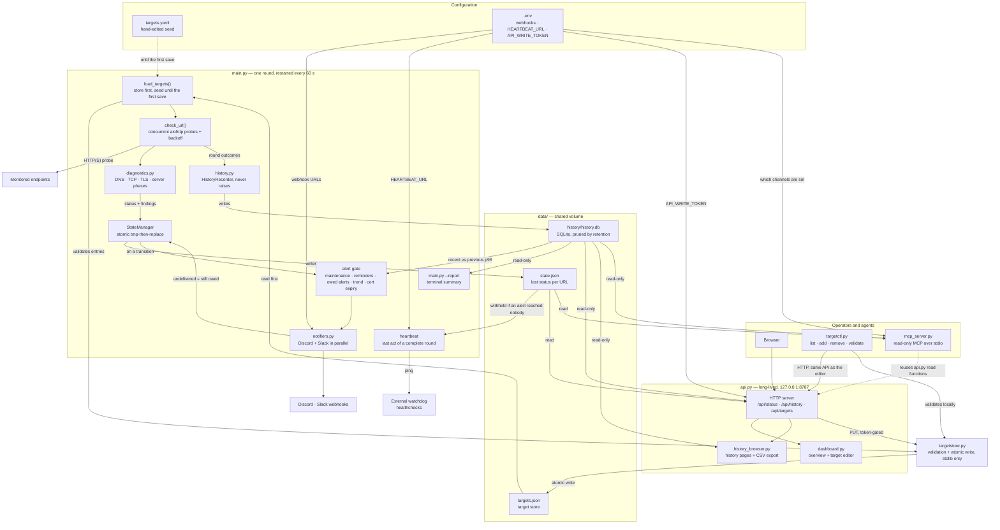
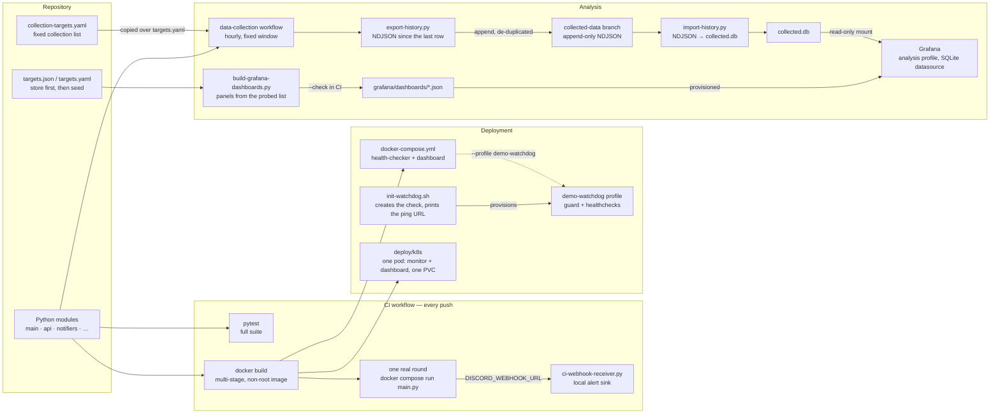

# Architecture

Two diagrams: what runs on every round, and what builds, ships and analyses it.
Every node is a file, a function or a store that exists in this repository; every
arrow is an import, a read, a write or a request that the code performs.

Dashed arrows are a fallback, an opt-in profile or reused code; solid arrows are
reads, writes, calls and requests.

## 1. Runtime

Two processes share the `data/` volume and nothing else: neither imports the other.
`targetstore.py` is stdlib-only so both can hold it. The monitor runs one round and
exits; compose (or the Kubernetes container loop) starts the next one 60 seconds later.
The API is the only process that writes the target list.

## 2. Build, deploy and analysis

CI proves the image runs one real round and delivers its alert. The data-collection
workflow ran the same `main.py` hourly inside a fixed window and appended the rows to a
data branch; Grafana reads a database rebuilt from those rows, never the live one.

